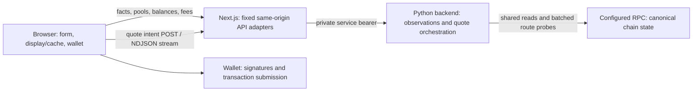

# Frontend and swap experience audit

✅ marks implemented or completed work; each entry states its verification
scope. Items marked “Deferred” or “Evaluation” remain open. Deployment and live
wallet verification are recorded separately with the release PRs.

The latest swap architecture already addresses much of the expensive quote
orchestration: token quote work is consolidated into streamed backend intents,
the browser retains completed display values during revalidation, and equivalent
reads are shared. The largest immediately removable loading cost was static
imagery. Interaction and long-session quote issues were also found and repaired.

This audit starts from App `b07e862` (current `dev` on 2026-10-05), with backend
source `bd22213` inspected for the request path. The older primary App checkout
`0e38a1a` is not the audit baseline. Changes are isolated on
`feature/frontend-swap-audit`. The follow-up implementation starts from App
`f775e209` on `feature/frontend-swap-followups` and integrates `dev` through
`9f3bd93`. Measurements below describe local
production builds and synthetic browser fixtures; they do not establish deployed
Core Web Vitals or live transaction performance.

## October 9 reconciliation of completed work and release boundaries

The following status supersedes the historical local-preview and release-candidate
wording in the dated sections below. A green tick establishes the stated
implementation or verification scope; it does not imply a funded wallet test
or deployment to a second environment.

| Completed item | Verified scope |
| --- | --- |
| ✅ Frontend message, fee, layout, token-selection and wallet-panel changes | Released with the earlier frontend batch. The net quote/settlement correction, immediate obsolete-request cancellation, hidden-tab suspension and selected-plan requalification are also included. |
| ✅ MetaMask SDK request batching | Released on Sandbox and Mainnet through App PR197/199. The isolated Sandbox wallet/SDK experiment qualified pending-approval behavior; Mainnet public acceptance was read-only. |
| ✅ Native ETH MAX gas reserve | Released to dev/Sandbox through App PR202, with local arithmetic/browser qualification and live fee/quote verification. |
| ✅ Execution tolerance and flow-specific fee-card bounds | Concurrent App PR204 is merged into dev and included in the observed Sandbox release. The expandable fee section offers 0%–1% tolerance, defaulting to 1%, and displays the active flow's minimum output for an input budget or maximum input for an output target. Cap-aware MAX and later basket-bound corrections are also in this dev release. |
| ✅ Persistent Sandbox development runtime and public HMR | Released through App PR207. Development assets, HTTP 101 and a Next `sync` frame are observed; Mainnet retains its production runner. |
| ✅ Safe Backend RPC diagnostics | Backend PR80 preserves available method, stage, elapsed time, upstream code, safe provider message and failure type in API diagnostics and correlated logs. Sandbox API observations demonstrated the feature. |
| ✅ All-failed-route diagnostic propagation | Backend PR82 closes the later aggregation gap: `route_failure()` retains the selected member's diagnostics when no route succeeds, including the terminal quote stream and correlated log. Its regression covers all four token purchase/redemption modes. This defect is no longer open. |
| ✅ Sandbox relay timeout response | Ops PR16 returns HTTP 504 and emits a structured timeout log instead of closing the caller connection. Local transport regressions pass; the owner pulled the merged Ops source and restarted the Sandbox service, followed by successful public fee/quote observations. |

At the October 9 public verification, Sandbox App serves dev `eaf6f96` and
Mainnet App serves production `a823ee4`. Backend dev is `28bd5b0`; Mainnet source
remains `c788dea`. These identities describe the recorded release boundaries,
not a new Mainnet promotion. The newer ETH MAX, execution-tolerance/cap-aware MAX,
Sandbox development-runtime and Backend diagnostic changes require a separate
reviewed dev-to-main promotion;
Sandbox development mode must continue to be selected only for Sandbox. No
funded ETH MAX or Mainnet wallet settlement is claimed.

Release/source references:
[App PR202](https://github.com/CyberGold-io/cybergold-app/pull/202),
[App PR204](https://github.com/CyberGold-io/cybergold-app/pull/204),
[App PR207](https://github.com/CyberGold-io/cybergold-app/pull/207),
[Backend PR80](https://github.com/CyberGold-io/cybergold-backend/pull/80),
[Backend PR82](https://github.com/CyberGold-io/cybergold-backend/pull/82),
[current dev route failure propagation](https://github.com/CyberGold-io/cybergold-backend/blob/28bd5b0440483287d92255fd88ef91c82b9be6d6/python-candidate/src/cybergold_candidate/quote_intent.py#L95-L100),
[all-failed-route regression](https://github.com/CyberGold-io/cybergold-backend/blob/28bd5b0440483287d92255fd88ef91c82b9be6d6/python-candidate/tests/test_quote_intent.py#L301),
[Ops PR16](https://github.com/CyberGold-io/cybergold-ops/pull/16).

## October 9 Sandbox development runtime

The owner requested persistent development mode for the deployed Sandbox App.
The new `development` Docker target packages full source and dependencies and
runs `next dev --webpack`, using the existing slot hostname/port and image
commit. Ops selects that target for the Sandbox profile; the default `runner`
remains the production standalone image for Mainnet and other profiles.
The existing Docker restart policy retains the selected image command, so
ordinary restarts and later Sandbox image replacements keep development mode.

Development permits the Sandbox public hostname for development assets and
WebSocket connections. The Next corner indicator is hidden, and stale market
data diagnostics go to development console debug logs instead of a page banner.
Unknown/expired valuation behavior remains unchanged. The owner installed the
development WebSocket route in the Sandbox HTTPS server and successfully tested
and reloaded Nginx.

Canonical local checks pass 445 unit cases, lint, TypeScript, authored docs,
ABI/workflow/release checks and a production build. The actual development
container serves the swap page, dashboard and head API after a fresh creation
and an explicit restart. Quote chunks arrive incrementally, and the Sandbox
origin completes the development WebSocket handshake. Three focused browser
cases pass in each mode: development logs diagnostics, production stays quiet,
and neither displays a banner. Those local fixtures are synthetic. Public
Sandbox adoption is now verified through PR207: commit `eaf6f96` serves the Next
development entry and React Refresh runtime; the public WebSocket returns HTTP
101 and an actual Next `sync` frame. A live read-only 0.1 XAUt issuance quote
streams to completion in 3.962 seconds, with matching display/execution amounts
and an input ceiling of 0.1 XAUt. Mainnet still serves production commit
`a823ee4`. No funded wallet settlement or B2B server reboot is claimed.
Development compiles routes on demand, so compare user-facing performance using
production builds rather than treating development timings as Core Web Vitals.

## October 9 native ETH MAX gas-reserve release

The owner authorized this local improvement and its normal **dev / Sandbox** PR
release. The candidate starts from App `220cfdc` on `feature/eth-max-gas-reserve`.

| Item | Status |
| --- | --- |
| ✅ Reserve the current transaction gas budget when using native ETH MAX | MAX uses the current ETH balance minus the current native-flow gas estimate, floored at zero. The existing estimate already includes the 20% base-fee margin and priority fee; it is reused once, without an extra percentage or fixed ETH reserve. |
| ✅ Match the current native execution flow | Native ETH purchases use one payable Helpers transaction. Helpers wraps and routes the ETH within that transaction, so MAX reserves gas for that call rather than an obsolete sequence of wrap, approval and swap transactions. |
| ✅ Keep the interaction quiet | The change affects native ETH MAX only. Manual amounts, ERC-20 MAX and ordinary wallet error recovery keep their existing behavior. No extra warning, reserve message or swap admission check is introduced. |

Local qualification passes all 422 unit cases, zero-warning lint, TypeScript,
authored documentation, ABI/workflow/release checks and the production build.
Four focused arithmetic cases and eight production-browser cases cover exact
wei, a single inclusive gas deduction, fresh fees during retained grey display,
zero clamp, unchanged ERC-20/manual entry, delayed/unavailable fee reads, and
accepted Swap terms while an older MAX fee read completes.
The combined ETH MAX, disconnected-gas, purchase-slippage and wallet-balance
production-browser run passes all 40 cases without retries. The browser wallet
and Backend responses are synthetic. Dev PR
[#202](https://github.com/CyberGold-io/cybergold-app/pull/202) merged and exact
Sandbox adoption, assets/rendering and recovered live fee/issuance/redemption
observations passed. Mainnet promotion and funded wallet settlement are not
claimed for that batch.

## October 8 full Mainnet request-batching release

The owner authorized the full MetaMask SDK request-batching implementation for
Mainnet, through the existing feature → dev → main PR release path. This
candidate starts from qualified Sandbox App `b6e5974` and removes the
Sandbox-only transport selection. It uses the existing Core, Helpers and
Permit2 contracts. No contract deployment or wallet account upgrade is needed.

| Item | Status |
| --- | --- |
| ✅ Enable optional request batching on configured Mainnet and Sandbox | ERC-20 and basket purchases can prepare the selected desktop MetaMask extension's SDK transport on either network. The App no longer restricts this selection to chain 31338. |
| ✅ Preserve atomic priority and ordinary fallback | Already-supported atomic accounts keep their existing path. Other wallets, mobile connections and unavailable SDK transports quietly retain ordinary submission, including the final-approval/signature overlap. No new swap admission check is added. |
| ✅ Request approval and swap confirmations without an App mining wait | Permit2 signing remains first, followed by approval(s) and the Helpers request through the SDK. Each request still needs its own wallet confirmation. This is non-atomic batching: first use still requires three confirmations and two transactions for a single token. |
| ✅ Retain selected-provider identity, submission tracking and quiet UX | The SDK and observer remain linked to the selected raw extension. Partial submissions retain their existing receipt recheck without automatic replay; production adds no batch badge or diagnostic message. |

Eighteen focused utility cases pass with the request-batch fixture configured
for chain 1. The Mainnet-ready-account case verifies that approval and swap
requests both carry `chainId: 0x1`, retain separate confirmation steps and start
no receipt wait before `submission.wait()`. These are fixture checks. Full local
canonical CI passes all 406 unit cases, zero-warning lint, TypeScript,
documentation, ABI/workflow/release checks and the production build. Twenty
focused Chromium wallet/slippage cases pass against the isolated production fixture, including
the installed SDK's signature → approval → Helpers request order while the
approval receipt is held, supported atomic priority and explicit ordinary
fallback. Wallet responses and backend observations in these cases are
synthetic; the SDK is the installed transport. Hosted checks, Sandbox adoption
and Mainnet deployment verification passed through App PRs
[#197](https://github.com/CyberGold-io/cybergold-app/pull/197) and
[#199](https://github.com/CyberGold-io/cybergold-app/pull/199).
The earlier Sandbox wallet results below establish their stated fork cases.
Mainnet wallet settlement remains unverified for this release.

## October 7 dev release and live Sandbox verification

For this October 7 release, the owner authorized App and Backend PRs into
**dev / Sandbox** while the Sandbox fork was being restored. This candidate
contains the locally reviewed CYGLD
capacity display, net settlement corrections, immediate obsolete-request
cancellation, hidden-tab quote suspension, selected-plan requalification,
mobile picker focus correction, faster preparation and compatible-account
approval/swap batching. The existing Core, Helpers and Permit2 contracts are
used. Contract deployment and wallet account upgrades are not part of this
release. Mainnet promotion was outside the authorization at that stage.

✅ App `977a2e70` and Backend `3cf2c9ac` are active on B2B Sandbox following the
owner's controller retry. Hosted checks and publication succeeded for
[App PR 191](https://github.com/CyberGold-io/cybergold-app/pull/191),
[App focus follow-up PR 192](https://github.com/CyberGold-io/cybergold-app/pull/192)
and [Backend PR 74](https://github.com/CyberGold-io/cybergold-backend/pull/74).
The public App footer serves the expected revision. The restored public RPC
reports chain 31338. Mainnet had not been promoted at that stage.

| Live deployed check | Status |
| --- | --- |
| ✅ Restored exact-in quote from 0.1 XAUt | Real public quote stream completed in 225 ms and returned 3.103296597373140686 CYGLD. This single observation is not a cold-start benchmark. |
| ✅ Disposable MetaMask connection and Sandbox faucet | A fresh test account connected to chain 31338 and was funded once through the existing wallet-panel faucet. No personal wallet was used. |
| ✅ Wallet rejection and recovery | Declining the first approval left the 0.1 XAUt form intact, with unchanged token balances and transaction nonce. No swap was sent. |
| ✅ First-use 0.1 XAUt issuance | Confirmed approval and Helpers transaction. Received exactly 3.103296597373140686 CYGLD; spent 0.099950 XAUt, with 0.000050 XAUt unused/refunded. Actual receipts, Helpers events and balance changes agree. |
| ✅ Issuance with existing token approval | A second 0.01 XAUt purchase received 0.310308932713892547 CYGLD and spent 0.009995 XAUt. No new token approval was requested; the Permit2 signature and swap transaction remain separate confirmations. |
| ✅ Redemption to XAUt | Redeeming 0.1 CYGLD confirmed successfully and credited 0.003213 XAUt, exceeding the submitted minimum of 0.003193 XAUt. Actual Helpers/Core events, historical wallet balances, transfer logs and supply changes agree. |
| ✅ Wallet panel with a real connected account | Language changes preserved the open panel; manual refresh, reload recovery, disconnect and reconnect passed. The deployed panel screenshot confirms ETH first and highlighted CYGLD second. |
| ✅ Real wallet capability and sequential fallback | MetaMask 13.13.1 returned an empty capability map for custom chain 31338. The App used sequential signing and did not request an account upgrade. Atomic wallet batching remains unverified on a genuinely supported deployed account. |

Public transaction evidence and the test screenshot are retained locally in
`out/audit/dev-swap-release/live-wallet/`. The earlier isolated contract proof
remains distinct from these real MetaMask submissions on deployed Sandbox.

## October 7 local signing overlap follow-up

The owner requested local review before any promotion to dev. These changes were
served by the existing preview at `http://127.0.0.1:3030/fr`; the Sandbox release
candidate below now includes them.

| Item | Status |
| --- | --- |
| ✅ Request the Permit2 signature while the final token approval is being confirmed | Single-token and basket issuance share the new ordering. Earlier basket approvals retain their existing order. The permit returns to swap submission only after signing and the existing approval receipt wait both complete. |
| ✅ Preserve cancellation and receipt-error recovery | Signature rejection returns promptly; a later receipt error remains handled. A receipt observation failure prevents the swap from being submitted and preserves the input. The change adds no automatic transaction replay or account upgrade. |

Validation passes 384 unit cases, 19 focused Chromium cases, changed-source lint
and TypeScript. The browser regression holds the approval receipt pending,
observes the Permit2 signature request, and verifies that the Helpers transaction
is sent only after releasing the receipt. Atomic and preapproved cases remain
covered. These are synthetic browser checks; the owner will inspect the updated
local app with their wallet before promotion.

**Batching clarification.** MetaMask request batching (`metamask_batch`) still
requires approval for each request. The App's atomic approval-plus-swap path uses
`wallet_sendCalls` only for an account/network reporting `supported`; an ordinary
MetaMask account uses EIP-7702 smart-account functionality for that path. Permit2
signing remains separate. The earlier suggestion of a second MetaMask mechanism
that reduces these confirmations for an ordinary Sandbox account was incorrect.

## October 7 Sandbox request-batching release candidate

For this October 7 candidate, the owner authorized promotion to **dev / Sandbox**
after local review. This candidate starts from App `2b0b71f`, including the latest
wallet-error diagnostics. Mainnet promotion was not authorized at that stage.
Existing Core, Helpers and Permit2 contracts are retained; no contract or backend
deployment is needed for this App change.

| Item | Status |
| --- | --- |
| ✅ Enable tested request batching on Sandbox | ERC-20 and basket purchases on configured chain 31338 prepare the selected desktop MetaMask extension's SDK transport before signing. Permit2 is signed first, followed by approval(s) and the Helpers call without an App approval-receipt wait. No query parameter is required. |
| ✅ Preserve ordinary and atomic submission | Supported atomic accounts keep their existing priority. Other wallets, mobile connections and unavailable SDK transports quietly retain ordinary submission, including the final-approval/signature overlap. Mainnet request-batching selection is unchanged. |
| ✅ Bind the SDK to the selected extension | A temporary property marker identifies the selected raw provider through SDK 0.33.1's wrapper and is removed immediately. A different wrapper retains ordinary submission before prompts; no additional RPC or account check is introduced. |
| ✅ Preserve partial submissions without replay | Approval-only interruption retains the form. A known Helpers hash retains receipt recheck even if the SDK's final response fails. Unrelated wallet-panel requests cannot enter this batch's transaction tracking. |
| ✅ Keep production diagnostics quiet | Public transaction phases and hashes are logged only in development mode. No batch badge, extra warning, signature or calldata is displayed or logged. |
| ✅ Declare the SDK dependency explicitly | The App directly pins the already-installed SDK 0.33.1; the resolved dependency versions remain unchanged. |

Thirteen focused utility cases, strict changed-source lint, TypeScript and an
independent source review pass. Full canonical release checks and genuine
production-mode MetaMask qualification run before publication. Hosted PR checks,
dev publication and the public footer's exact commit establish deployment;
publication alone is not evidence of host adoption.

The following experiment records the earlier local qualification. This release
candidate supersedes its development-only query switch. Request batching still
requires three wallet confirmations and two transactions on first use; it does
not provide atomic rollback or reduce the number of signatures.

### Deployed SDK connector follow-up

✅ [PR 194](https://github.com/CyberGold-io/cybergold-app/pull/194) merged and
App `08e27dd` was published and adopted on Sandbox. Both PR and merged-dev CI
passed 401 unit cases and 246 Chromium cases, with three expected fixture skips.
The public French/English routes, static assets and backend facts respond
successfully on chain 31338. This October 7 follow-up left Mainnet unchanged.

The live disposable-wallet purchase spent 0.009995 XAUt and received
0.310308268043975081 CYGLD. Both receipts and independent historical settlement
checks pass, but SDK handler coverage is zero: ordinary fallback was selected.
The public WalletConnect configuration selects RainbowKit's SDK-backed MetaMask
connector, whose provider is the SDK Proxy. The initial production-mode local
test used the direct injected connector. A fresh, unfunded public read-only
probe confirms that the selected Proxy transparently links to the announced
raw provider; direct object equality does not recognize that wrapper.

✅ The targeted follow-up resolves the announced raw MetaMask provider through
the existing temporary property linkage for either connector shape. It binds
the SDK and observer to that raw provider, preserving ordinary fallback, atomic
priority, Mainnet routing and partial-submission recovery. No RPC, account or
liveness requirement is added. Seventeen focused tests, TypeScript, strict lint
and independent review pass, including the actual SDK connector shape and
unrelated-provider regressions. Genuine qualification uses the public SDK
connector configuration before the follow-up release. Evidence is retained in
`out/audit/metamask-request-batch-sandbox-release/`.

## October 7 local MetaMask request-batching experiment

✅ Initially implemented an explicit local development experiment at
`http://127.0.0.1:3030/fr?walletRequestBatch=1`. It signs Permit2 first, collects
the required token approvals, then calls the installed MetaMask SDK's genuine
`metamask_batch` method with approval(s) and the signed Helpers transaction.
The installed SDK version is 0.33.1 and takes a flat request array. It is loaded
only for that experiment; its normal URL retained the existing submission path.

The App does not wait for approval receipts before requesting the swap and
does not provide a gas limit, nonce override or state override to conceal the
wallet's simulation behavior. Every wallet request still needs its own
confirmation. Once submitted, the App observes all receipts before announcing
success. A stopped batch retains already-broadcast approval hashes in local
diagnostics, preserves the form and never replays its requests automatically.
An approval hash alone is not reported as a submitted Helpers swap.

✅ Validation passes 390 unit cases, 19 focused Chromium regressions, changed
source lint and TypeScript. The new unit cases cover partial broadcast,
rejection, receipt rechecks, reverted receipts and diagnostics without signed
payloads.

✅ Actual MetaMask 13.13.1 and SDK 0.33.1 qualification passes two full purchases
on an isolated local clone of Sandbox chain 31338, using fresh disposable
accounts with zero initial Permit2 allowance and the canonical Uniswap adapter.
The first case uses normal mining. The second disables mining, observes the
swap confirmation while the approval receipt is still absent, and confirms
both transactions before mining resumes. No native simulation warning is
observed, and both transaction hashes return before mining. Approval nonce 0
and swap nonce 1 then confirm successfully in the same block. The App confirms
the purchase and independent token balance/receipt checks agree with settlement.
No transaction gas limit or state override is supplied by the experiment.

The held case spends 0.099950 XAUt from a 0.1-XAUt maximum and receives
3.103288629761152942 CYGLD, preserving the unused input. This establishes the
tested behavior on the isolated fork and those installed wallet/SDK versions;
it does not establish an atomic rollback or a universal batch-simulation
guarantee across RPC providers and wallet versions. There are still three
wallet confirmations. Public reports are retained in
`out/audit/metamask-request-batch-local/`. The user's preview on ports 3030/3032
is retained; disposable test wallets and isolated servers are cleaned up.

The original experiment used its query URL with MetaMask on Sandbox and a
token needing its first Permit2 approval. Tokens already approved
retain their ordinary single-transaction path. Development console entries
prefixed `[wallet-request-batch]` record method phases and public transaction
hashes without typed-data signatures or calldata. The Sandbox release candidate
above replaces that opt-in switch with optional default transport selection.

## October 7 native-permit and request-batching evaluation

✅ Read-only checks of the deployed token contracts on Sandbox (31338) and
Ethereum Mainnet (1) confirm the following ERC-2612 support:

| Token | Sandbox | Mainnet |
| --- | --- | --- |
| USDC | Supported | Supported |
| PAXG | Supported | Supported |
| XAUt | Supported | Supported |
| USDT | Unsupported | Unsupported |

Six valid permit simulations succeeded for the three supported tokens, using a
fresh unfunded account and network-specific EIP-712 domains. These were
`eth_call` simulations: no transactions were broadcast, and token nonces and
allowances remained unchanged. Public results are retained in
`out/audit/token-native-permit/deployed-token-probes.json` and
`out/audit/token-native-permit/valid-permit-simulations.json`. Helpers purchases
still lack a native-token permit entrypoint; permit-plus-purchase execution is a
follow-up, not implemented or deployed.

Signing Permit2 first makes a non-atomic approval-plus-swap request batch
constructible. The installed desktop MetaMask SDK queues ordinary requests
without an application receipt wait. The wrapper alone did not establish
pending-approval simulation behavior. The controlled experiment recorded above
subsequently qualified uninterrupted confirmation for the stated local fork,
MetaMask and SDK versions. It does not establish universal wallet/provider
behavior. Request batching retains three confirmations on first use and two
on-chain transactions.

Automatic authorization selection can use verified token capability metadata
and current nonce/domain observations, keeping the existing Permit2 flow for
tokens without native permits. ERC-2612 has no universal capability-discovery
method; a successful domain read alone is insufficient proof. Helpers should
execute the selected native permit rather than interpret every permit error as
unsupported-feature discovery.

## October 6 wallet panel polish batch

These changes follow App `97d301a` and were reviewed by the owner in the local
preview using the existing Sandbox backend. The authorized release path is
`feature/wallet-panel-polish` into `dev`, followed by `dev` into `main` after
the automated Sandbox deployment passes verification. Sandbox development mode
was separate at this stage and is now completed in the October 9 release above;
the broader optional audit evaluations remain open.

| Item | Status |
| --- | --- |
| ✅ Zero Helpers fees use the same fiat formatting as other fees | Uses the selected currency formatter, including its symbol, precision and approximation prefix: `0 CYGLD (~ $0.00)` in English/USD. Unknown values still use placeholders. |
| ✅ Desktop wallet panel shares the page below the full-width navbar | Reserves 440px beside the main content and footer, with no modal backdrop or focus trap. Swap selection, amount editing and navigation remain usable. Mobile retains its scrollable modal; resizing switches between both presentations. |
| ✅ Disconnect replaces Wallet options | A single disconnect action sits beside the network control. The duplicate bottom action and its redundant options handler are removed. |
| ✅ Wallet actions share the title row | Network, refresh and disconnect sit to the right of “Your wallet”, in that order. Network and refresh use the same gold circles. Network uses a globe with the current network in its localized tooltip and accessible name. Refresh retains its spinning/disabled state; disconnect uses the power symbol. All three use 40px circles without visible text labels. |
| ✅ Remove the wallet total balance block | Token balances and their individual valuations remain. The combined total, its calculation and recovery-share copy referring to that total are removed. |
| ✅ Wallet balances show ETH first and CYGLD second | Remaining tokens retain their order. CYGLD has a subtle gold background and border using the theme color. This ordering is local to the wallet panel. |
| ✅ Wallet address toggles the panel; redundant navbar controls and popup are removed | The address button displays only the abbreviated address, with inverted colors while open. Another click closes the desktop panel. The separate dots, navbar ETH balance and account-popup trigger are removed. Desktop has no duplicate close action; mobile keeps its dialog close action for touch dismissal. |
| ✅ Language changes preserve the wallet panel | Its open/closed state survives locale navigation, while its labels change with the selected language. A closed panel stays closed. The state is held only in browser memory, with a fresh page load starting closed. |
| ✅ Network chooser preserves the wallet panel | Opening or dismissing the chooser keeps the wallet open. On mobile, the wallet remains visible behind the chooser and resumes its modal keyboard behavior when the chooser closes. |
| ✅ Address copy uses quiet icon feedback | Successful copying turns the copy icon the same theme gold as the network and refresh buttons for one second. Its normal color is the theme text color. Repeated copies restart that interval. Remove the “Address copied” message and changing tooltip; retain the localized copy action label. |
| ✅ Footer uses two aligned blocks of two lines | Remove the redundant CyberGold wordmark and maintenance sentence. Copyright/location sit on the left; the inline contact label/email and deployed commit sit on the right. Both blocks share top alignment, line height and row spacing, with the existing stacked mobile layout. |

**Verification.** Focused Chromium checks pass and cover fee continuity/formatting,
desktop geometry and swap interaction, mobile keyboard behavior, responsive
resizing, balances, manual refresh, token import, disconnect/reconnect and language
changes between English, French and German with the panel open or closed.
Changed-source lint, TypeScript and documentation checks pass. The local preview
at `http://127.0.0.1:3030/fr` returns successful page, protocol and gold responses
against the Sandbox backend on chain 31338. No live transaction was performed.
Subsequent live reads intermittently returned RPC timeouts after about 15 seconds,
including protocol facts and pool observations; the App displayed the localized
RPC timeout reason. This limits live quote testing while the backend RPC is slow.

## October 6 streamline feedback batch

This batch starts from App `9ed53bd` and Backend `5804d34`. Its release target
is **dev / Sandbox only**. Promotion to main requires new owner authorization.

| Item | Status |
| --- | --- |
| ✅ Fresh sell selection asks for a token; receive defaults to CYGLD | Implemented and browser verified. Explicit saved selections remain restorable. |
| ✅ Wallet-only filter appears only while connected | Implemented and verified. A disconnected saved filter does not restrict the token list. |
| ✅ Receive picker exposes every configured asset | Implemented and verified. Selecting a non-CYGLD receive asset sets sell to CYGLD and resets the earlier quote. |
| ✅ Helpers fees include fiat for zero as well as priced nonzero values | Implemented and verified. Unknown prices remain unknown. |
| ✅ Market freshness diagnostics stay out of the page in both environments | Implemented and verified. Development mode uses console debug logs; production stays quiet. |
| ✅ Backend preserves actionable quote/RPC causes and App localizes them | Implemented and verified. Rate limits, timeout, denied access, transport failure, contract rejection and missing route have distinct codes; provider payloads stay private. |
| ✅ Desktop three-dot control opens a right wallet panel | Implemented and verified. Mobile uses the full viewport, with scrolling, focus return, refresh, address icons, options, network actions, existing faucet and disconnect. Explicit disconnect suppresses provider fallback during the app session; reload behavior is retained. |
| ✅ Start Sandbox App in development mode | Implemented, deployed and verified through PR207. The dedicated development image retains its command across restarts and future Sandbox releases. Local fresh-container/restart checks pass; public development assets, incremental live quote completion and the Nginx WebSocket upgrade with a Next `sync` frame are verified. Mainnet retains its production runner. |
| ✅ Confirm the deployed Sandbox quote failure cause | The 0.1 XAUt stream returned `rpc-unavailable` during the fork outage. After the fork was restored, the same quote and actual wallet execution passed. No evidence establishes exhausted provider quotas. |

**Verification.** Canonical App checks pass with 364 unit cases and a production
build. The complete production Chromium suite passes 209 cases with three
existing Sandbox-generation fixture skips. Development-mode diagnostics and picker checks pass 15 browser cases;
wallet and transaction checks cover explicit selection, manual refresh,
disconnect/reconnect, submitted-hash recovery and spending-balance checks.
Backend validation passes 219 Node cases, 285 Python unittest cases and its full
local Node/Python comparison suite. No live transaction was performed.

**Market acquisition and observations.** Browser hooks request the same-origin
Next API adapters; the backend contacts Binance PAXG/USDT for gold and
Frankfurter for FX. Backend fresh cache lifetimes are 30 minutes for gold and
5 minutes for FX, with coalescing and optional shared Valkey caching. Browser
refresh follows those remaining lifetimes, retrying fallback data after 10
seconds; hidden tabs pause timer polling. These are application fetch/cache
intervals, not the suppliers' publication cadence.

On October 6 both publicly deployed FX adapters returned `stale: true` and
fallback rates, while gold returned fresh values. The former warning depended
on the selected display currency, so a USD tab and a EUR/CHF tab could differ.
A read-only check found the public Sandbox wallet RPC responding to chain,
head and Core pause reads; it did not prove the backend's own RPC connection
was healthy. No evidence establishes exhausted RPC quotas or account flagging.
A safe supplier-failure diagnostic header and backend logs distinguish HTTP
refusal, timeout, unreachable supplier and invalid response without adding
product text or exposing provider URLs/credentials. Local Frankfurter HTTP403
probes do not establish the deployed backend's supplier response.

## Applied improvements

| Finding | Change | Evidence |
| --- | --- | --- |
| ✅ Large page/footer backgrounds | Serve the existing designs as WebP at unchanged dimensions | Light: 2,185,388 to 251,966 bytes; dark: 1,998,890 to 199,516 bytes; combined reduction 89.2%. Visually compared against the originals. |
| ✅ Full-size favicon | Resize to 64 by 64 with transparent padding and preserved aspect ratio | 2,154,639 to 3,128 bytes, a 99.85% reduction. |
| ✅ Header uses a 2048-pixel logo for a 22-pixel display | Add the actual rendered size to Next Image | Previous generated candidates: 2048/3840 pixels. Production browser inspection selects a 32-pixel image for the 22-pixel display. |
| ✅ Opening balances downloads raw full-size token icons | Use the existing Next Image optimizer for 22-pixel balance icons | Removes the raw 2,154,639-byte CYGLD display request; wallet token-import icon URLs retain their existing behavior. |
| ✅ Connected wallet's hidden balances panel subscribes to protocol/pool/market data before opening | Mount on first opening, retain afterward | Removes initial hidden subscriptions while preserving the existing faucet request identity and transient state across closing/reopening. |
| ✅ Balance-panel JavaScript is included through the global wallet button | Dynamically import the panel at its existing first-opening boundary | Shared-layout gzip inventory falls by 7,333 bytes (2.4%). Two chunks totaling 14,463 raw / 5,584 gzip bytes are observed loading on first opening in the swap test. |
| ✅ Wallet connection disabled by an empty/unquoted form | Let the disconnected swap-card action open the wallet chooser | Connected swap prerequisites retain their current behavior. |
| ✅ Wrong-chain action can give an unrelated amount message and miss an unsupported wallet chain | Observe the connected wallet's chain and display the existing network-check reason | Preserves the prior configured-chain fallback for provider-only account observations. The action identifies the network to switch to. |
| ✅ Inputs/filter/dropdown lack keyboard and accessible naming support | Associate labels, add focus styles, localized picker search and dialog semantics, arrow navigation, Escape dismissal and focus return | Covers individual token amounts, basket amounts, wallet filter and picker. Existing quote presentation is retained. |
| ✅ Basket icons overflow their intended size and crowd the weight/amount focus outline | Constrain icons to their declared 22-pixel dimensions and use the existing 104-pixel label width on desktop | Production DOM showed 32-pixel icons and a 100% label overlapping the amount field. |
| ✅ MAX disappears on narrow screens | Show the existing token MAX control on mobile | Uses the existing balance and amount calculation; no new native-gas budget behavior. |
| ✅ White text on the gold action buttons is hard to read | Use dark text on gold | Connect button contrast changes from approximately 1.88:1 to 10.57:1. |
| ✅ Deadline renewal leaks into later quote inputs | Recompute the existing deadline producer on renewal and new input | Reproduced an expired deadline after renewal, clearing the form and a long idle period. Also reproduced a missed completed-quote cache hit after renewal. |

For light-theme pages that display both the light swap background and dark
footer background, background plus favicon source bytes fall from 6,338,917
to 454,610 (92.8%). These are file-size savings; browser caching, compression,
image optimization and network conditions determine actual transfer and paint
times. They are not a measured Core Web Vitals improvement.

Sources: [styles](../../app/globals.css), [header](../../app/components/navbar.tsx),
[wallet UI](../../app/components/walletConnectButton.tsx),
[swap page](../../app/[locale]/page.tsx),
[picker](../../app/components/tokenPickerModal.tsx),
[intent hook](../../app/hooks/flows/quotes/useQuoteIntent.ts).

## Follow-up improvements

| Finding | Change | Evidence |
| --- | --- | --- |
| ✅ A submitted hash followed by a receipt outage looks like a failed swap | Preserve the hash, distinguish unavailable confirmation from a known revert, offer an explorer link and read-only confirmation recheck | Browser regression covers success and revert after the outage, with one signature and one transaction submission. |
| ✅ External transfers leave the wallet filter and MAX stale | Add manual refresh to the balance dialog, expose loading/partial errors | Browser fixture changes a balance and verifies MAX updates without reconnecting; an unavailable read recovers through refresh. |
| ✅ Wallet balances may change between entering amounts and pressing Swap | Complete a fresh balance read on Swap and compare the required spending assets before wallet prompts | Covers reduced/unavailable balances, an endpoint outage, a delayed successful read and basket exact-in/exact-out. Unrelated unavailable assets do not block spending. |
| ✅ One slow pool delays unrelated available valuations | Publish independent pool observations immediately; show known row/fee values | A held unrelated gold pool does not delay the known ETH wallet valuation. |
| ✅ Missing prices can produce misleading partial basket or wallet totals | Leave the total unavailable until each nonzero component can be valued | Unit coverage includes missing prices in either component order, zero/empty amounts, and localized input. |
| ✅ Balances overflow short screens and lack modal focus handling | Use a labelled native dialog with scrolling, keyboard cycling, Escape and focus return | Production browser case uses a 390 × 420 viewport and checks both ends of the keyboard cycle. |
| ✅ Dashboard imports the full chart engine | Register only the chart modules used by the existing wrappers | Chart engine gzip inventory falls 42.2%; the dashboard still renders its three supported charts. |
| ✅ Applied slippage is hidden | Show tolerance in fee details | The original fix displayed the existing 1% policy. PR204 now exposes an adjustable 0%–1% execution tolerance and the active flow's execution bound. |
| ✅ Some dashboard and faucet actions still use low-contrast white text on gold | Apply dark text to the existing gold backgrounds | Extends the same contrast correction as the swap actions. |

New transaction and balance status text is translated in English, French, German
and Russian. Gas budgeting and connector support retain their existing behavior.
On 2026-10-06 the owner
confirmed that connection/opening fetches and manual refresh are sufficient for
ordinary wallet balances. The owner also chose the same on-demand pattern for
recovery shares; their periodic polling has been removed.

## Browser, Next.js and backend

The browser sends product requests, rather than generic public RPC requests.
`/api/rpc` is retired in the current App. Next.js forwards fixed paths to its
configured backend, applies its private service bearer, propagates the request
abort signal and forwards the quote stream directly. Browser credentials do not
supply this bearer. Wallet connection, signing and submission remain browser
operations.

Wallet SDK downloads and any connector relay/session traffic follow a separate
browser/wallet path, governed by the connector configuration. They do not pass
through the App's observation/quote proxy or share its backend caches.

The current token flow is:

1. Input changes update local display immediately and debounce quote work by
   100 milliseconds, with the debounce bypassed for an exact completed browser
   cache hit. Driver changes, head changes, expiry and cache reuse have
   distinct effects; optimizing them as one generic loading state risks stale
   execution or unnecessary work.
2. The browser checks its existing completed quote/model state and sends one
   `/api/quotes/intent/stream` request when exact work is required.
3. Backend orchestration acquires canonical state, constructs route candidates,
   shares pinned reads and equivalent active intent work, evaluates routes and
   applies the existing correction/preview process. Historical models serve
   display while exact execution is qualified separately.
4. NDJSON events carry estimates, progress, qualified plans and completion.
   Next forwards these chunks without first collecting the entire response.
5. Submission continues through the existing wallet and Helpers path. Read
   outages never justify automatic replay of a signed transaction.

The configured Python runtime explicitly enables `IntentSharing`, retained
plans, `VerifiedGrossSeed`, `BasketMath`, `QuoteHistory`,
`delayed_local_step` and completed Quoter reuse. It does not import the held
variants in `quote_experiments.py`. Full active intents share by complete
request plus canonical block hash; different deadlines or retained plans limit
these joins. Their entry is removed at completion. This is separate from the
pinned-read caches: Mainnet pool reads retain successful hash-addressed values,
while successful Quoter/basket math and verified exact gross seeds have
ten-second completed reuse. Gross-seed identity excludes deadline and
retainedPlan, but every caller still performs current forward validation.
Sandbox keeps only overlapping pool/Quoter/basket reads where administrative
state replacement can occur. These banks are local to each service instance
and API process, so replicas/restarts do not inherit one another's warm state.

Backend source at the inspected revision: [runtime wiring][backend-runtime],
[full-intent identity and lifecycle][backend-intent-sharing],
[Quoter/basket/seed reuse][backend-quote-cache],
[pinned pool reuse][backend-pool-reuse].

The browser head watcher pauses when hidden; on Mainnet it schedules around
12-second slots and uses actual returned hashes to refresh observations. Facts
are reused by hooks and invalidated on changed heads. Pool valuation reads
share five-second TanStack queries. These browser policies are separate from
backend provider instances and upstream RPC caching.

Stream cleanup cancels the departing subscriber; a shared producer stops only
after its last subscriber leaves. Optional display-model acquisition may
continue after completion without holding the quote open. Source-level abort
propagation does not establish deployed ingress/disconnect behavior.

Sources: [fixed proxy](../../app/server/backend-client.ts),
[head watcher](../../app/utils/chainHead.ts),
[facts hook](../../app/hooks/protocol/useProtocolFacts.ts),
[pool observations](../../app/utils/poolSnapshot.ts),
[stream reader](../../app/utils/quoteIntent.ts),
[API architecture](../architecture/backend-http-contract.md).
Backend: [stream cleanup][backend-stream], [subscriber cancellation][backend-cancel],
[shared-read cancellation][backend-shared-reads],
[optional model acquisition][backend-model-acquisition].

## Remaining work and optional evaluations

The implemented product changes above are complete within their recorded
release scope. The following release and wallet-validation steps remain
separate from those completed implementations.

| Release or validation item | Status |
| --- | --- |
| Mainnet promotion of newer dev changes | Separate release — ETH MAX, execution-tolerance/cap-aware MAX and Backend diagnostic changes are qualified on dev/Sandbox; Mainnet remains at the earlier production release. Promote through reviewed PRs and normal automatic deployment when authorized, retaining the production Mainnet image target. |
| Funded native ETH MAX settlement | Validation — arithmetic, synthetic wallet/browser behavior and live fee/quote reads pass; an actual wallet transaction using MAX has not been qualified. |
| Mainnet SDK request-batching settlement | Validation — implementation, publication and public read-only acceptance pass; a genuine funded Mainnet approval-plus-purchase flow remains unverified. |
| Atomic batching with an actually supported wallet account/network | Validation — synthetic wallet tests and isolated Anvil smart-account execution/rollback pass. Genuine MetaMask reported no capability on custom Sandbox chain 31338; a supported deployed-account wallet test remains unverified. |

These are future implementations, rather than unfinished corrections in the
released frontend batch:

| Future implementation | Status |
| --- | --- |
| Native-token permit purchases and automatic authorization selection | Future work — native permits are validated read-only for USDC, PAXG and XAUt on both networks; USDT retains its existing path. Arbitrary token import, Helpers/backend/App integration and purchase qualification are described in the [ERC2612 implementation plan](https://github.com/CyberGold-io/cybergold-ops/blob/main/docs/work/future-work/helpers-app-ops-erc2612-token-purchases-implementation-plan.md). |
| Anvil Relay ownership and automatic delivery | Future work — the timeout repair is complete. Moving the separate relay runtime into Broker and giving it managed delivery/activation is described in the [Anvil Relay workplan](https://github.com/CyberGold-io/cybergold-ops/blob/main/docs/work/future-work/ops-anvil-relay-ownership-and-delivery-implementation-plan.md). |

The original audit also retains the following optional evaluations. They need
current deployed measurements before an implementation is selected; they are
not failures of the completed changes and introduce no new release gate.

| Optional evaluation | Status |
| --- | --- |
| Backend quote endpoint/stage telemetry and cross-hop attribution | Evaluation — RPC failure diagnostics are completed; streamed success/timing metrics and shared request identity across hops remain a different observation task. |
| Sharing pinned facts/pool reads and aggregate quote tail latency | Evaluation — retain current canonical/fork semantics. |
| Deployed buffering and disconnect propagation | Evaluation — public development streaming is verified; cancellation through the entire deployed ingress path still requires end-to-end evidence. |
| Deferring wallet dialog/provider code and connector SDK loading | Evaluation — profile coverage and the supported connector matrix. |
| Smaller action-specific ABI constants and shared account observation | Follow-up — implementation and compatibility evaluation remain. |
| Offscreen dashboard chart rendering | Evaluation — profile the deployed dashboard first. |
| Production cold-start layout shift and Core Web Vitals | Evaluation — synthetic geometry checks do not establish deployed CLS. |
| Additional transaction-details view or execution-deadline display | Deferred additional product proposal — not approved or implemented. This does not describe the existing fee card: PR204 already implements adjustable execution tolerance and flow-specific minimum-output/maximum-input values there. |

### Completed implementation: native ETH MAX reserves transaction gas

Native ETH MAX previously used the full wallet balance, leaving no explicit
budget for gas. The October 9 candidate subtracts the current native-flow gas
estimate from the current balance. That estimate already prices gas with the
existing 20% base-fee margin and priority fee, so the reserve does not add a
second margin or a fixed ETH amount. The current native purchase is one payable
Helpers transaction, including its internal wrapping and routed swaps. Manual
entry, ERC-20 MAX and wallet error recovery retain their existing behavior;
the page adds no warning or reserve explanation. Accepting Swap also cancels
an earlier pending MAX action before capturing execution. Local checks and the
eight focused browser cases pass; Sandbox release and recovered live fee/quote
verification passed. Mainnet promotion is separate.

Source: [MAX and native budget](../../app/[locale]/page.tsx).

### Medium: backend work and latency need endpoint/stage visibility

The October 5 baseline findings below refer to Backend `bd22213`, as pinned in
their source links. They identify evaluation targets, not a current claim about
every deployed implementation detail. The separate October 9 RPC diagnostic
work is completed as recorded above. A read-only source check at Backend dev
`28bd5b0` still finds the intent stream absent from the telemetry path list.

The baseline telemetry path list omits `/api/quotes/intent/stream`, the main
swap quote endpoint, and middleware labels it `unmatched`. Quote errors can be
NDJSON events under HTTP 200, so HTTP status alone cannot measure quote success.
Whole-response time also hides time to first model/estimate or first qualified
executable result. Use the existing
quote metrics and explicit event timing to distinguish these outcomes and
stages. At that baseline, browser diagnostics and backend requests did not carry a
shared request identity through Next, preventing per-request hop attribution.
This is an observation recommendation, not a new release/admission gate.

At the baseline, protocol facts repeat metadata reads at changed heads. Initial four independent
pool snapshots each acquire context/factory/state and verify canonicality; their
provider's sharing does not automatically share with facts or route providers.
Explore sharing already-pinned metadata/state reads only after measuring
actual backend/RPC cost. Retain canonical/fork semantics.

The baseline quote operations use 15-second stage timeouts, with up to eleven forward
evaluations in redemption exact-output correction; 15 seconds is not an overall
quote-time bound. The reported intent `totalMs` also excludes the outer
`IntentSharing` head acquisition. Measure aggregate tail latency
before changing cancellation, route strategy or timeouts. Deployed proxy
buffering and disconnect propagation need a real end-to-end check; local source
and unit tests do not establish ingress behavior.

Backend sources: [telemetry route labels][backend-telemetry],
[facts reads][backend-facts], [pool snapshot reads][backend-pool-producer],
[provider-instance sharing][backend-provider],
[correction loop][backend-correction], [intent timing][backend-intent-timing].
App sources: [browser diagnostics](../../app/utils/clientDiagnostics.ts),
[fixed proxy](../../app/server/backend-client.ts).

[backend-runtime]: https://github.com/CyberGold-io/cybergold-backend/blob/bd222133c5b15aebde4a1bbaa07122bbb5578d33/python-candidate/src/cybergold_candidate/runtime.py#L129-L136
[backend-intent-sharing]: https://github.com/CyberGold-io/cybergold-backend/blob/bd222133c5b15aebde4a1bbaa07122bbb5578d33/python-candidate/src/cybergold_candidate/quote_cache.py#L198-L249
[backend-quote-cache]: https://github.com/CyberGold-io/cybergold-backend/blob/bd222133c5b15aebde4a1bbaa07122bbb5578d33/python-candidate/src/cybergold_candidate/quote_cache.py#L18-L183
[backend-pool-reuse]: https://github.com/CyberGold-io/cybergold-backend/blob/bd222133c5b15aebde4a1bbaa07122bbb5578d33/python-candidate/src/cybergold_candidate/route_search.py#L93-L101
[backend-stream]: https://github.com/CyberGold-io/cybergold-backend/blob/bd222133c5b15aebde4a1bbaa07122bbb5578d33/python-candidate/src/cybergold_candidate/quote_intent.py#L477-L505
[backend-cancel]: https://github.com/CyberGold-io/cybergold-backend/blob/bd222133c5b15aebde4a1bbaa07122bbb5578d33/python-candidate/src/cybergold_candidate/quote_cache.py#L268-L272
[backend-shared-reads]: https://github.com/CyberGold-io/cybergold-backend/blob/bd222133c5b15aebde4a1bbaa07122bbb5578d33/python-candidate/src/cybergold_candidate/shared_reads.py#L70-L87
[backend-model-acquisition]: https://github.com/CyberGold-io/cybergold-backend/blob/bd222133c5b15aebde4a1bbaa07122bbb5578d33/python-candidate/src/cybergold_candidate/quote_intent.py#L459-L466
[backend-telemetry]: https://github.com/CyberGold-io/cybergold-backend/blob/bd222133c5b15aebde4a1bbaa07122bbb5578d33/python-candidate/src/cybergold_candidate/telemetry.py#L10-L41
[backend-facts]: https://github.com/CyberGold-io/cybergold-backend/blob/bd222133c5b15aebde4a1bbaa07122bbb5578d33/python-candidate/src/cybergold_candidate/protocol_facts.py#L60-L85
[backend-pool-producer]: https://github.com/CyberGold-io/cybergold-backend/blob/bd222133c5b15aebde4a1bbaa07122bbb5578d33/python-candidate/src/cybergold_candidate/pool_producer.py#L58-L85
[backend-provider]: https://github.com/CyberGold-io/cybergold-backend/blob/bd222133c5b15aebde4a1bbaa07122bbb5578d33/python-candidate/src/cybergold_candidate/rpc_transport.py#L9-L20
[backend-correction]: https://github.com/CyberGold-io/cybergold-backend/blob/bd222133c5b15aebde4a1bbaa07122bbb5578d33/python-candidate/src/cybergold_candidate/quote_intent.py#L386-L407
[backend-intent-timing]: https://github.com/CyberGold-io/cybergold-backend/blob/bd222133c5b15aebde4a1bbaa07122bbb5578d33/python-candidate/src/cybergold_candidate/quote_intent.py#L98-L113

### Medium: shared wallet JavaScript and dashboard charts remain substantial

The shared layout includes RainbowKit/Wagmi/Viem, query infrastructure,
application providers and contract ABIs; its size is not a wallet-only figure.
Some wallet SDKs, icons and locale files already have separate dynamic chunks.
These dependency inventories exclude framework/runtime chunks and are not
executed-code coverage or complete initial network payloads.

✅ **Completed:** the balance-panel code split is a measured first improvement:

| Inventory | Before code split: raw / gzip bytes | After code split: raw / gzip bytes |
| --- | --- | --- |
| Shared layout | 1,038,532 / 305,499 (14 chunks) | 1,017,432 / 298,166 (13 chunks) |
| Swap plus shared layout | 1,178,054 / 349,444 (20 chunks) | 1,170,599 / 347,767 (20 chunks) |

The layout gzip reduction is 2.4%. Shared modules move between entries, so
the layout reduction is not the swap's complete network saving. A native
browser resource observation in the new wallet test confirms that the panel's
two additional scripts load on first opening: 14,463 raw / 5,584 gzip bytes.
The remaining shared valuation chunk is already needed by the swap. Closing
and reopening preserves the token-import feedback and existing retry identity.

Local wallet feedback on 2026-10-08 supersedes this code split: the panel now
loads with its button so a first click does not wait for the additional scripts.
Its components still mount only after first opening. Following the owner's
Multicall3 request, one shared wallet snapshot now combines six ERC20 balances
and ETH in a single `aggregate3` call. All token rows remain visible while the
snapshot or individual prices are pending or unavailable; a failed asset stays
unknown without hiding successful assets. The fresh complete wallet snapshot
is still used before a swap prompts the wallet.

Larger improvements have clear implementation boundaries:

- RainbowKit's global provider eagerly includes the connect, account and chain
  dialog UI. Deferring that UI needs an application modal-opening bridge and a
  lightweight wallet-status component. Keep Wagmi configuration, account state,
  query contexts and restored sessions available. Splitting just the button or
  lazily wrapping the entire provider is not a drop-in correction.
- Connector setup can itself trigger WalletConnect/MetaMask SDK imports when
  configured, before the chooser opens. Measure the deployed connector matrix;
  a dynamic import alone does not prove loading waits for user interaction.
- Action-specific generated ABIs can reduce raw parse cost. Existing flow
  modules filter whole generated arrays at runtime; preserve function fragments
  and relevant custom errors when making smaller generated constants.
- Account observation repeats provider listeners and 800-millisecond polling
  across four initial swap consumers, with additional consumers after opening
  balances. A shared observation can reduce background work while retaining
  the existing mismatch/disconnect and refresh behavior.

Capture production coverage and main-thread work before the larger provider or
transaction-flow refactor. Verify reconnect, first wallet prompt, nonce and
retry behavior across supported wallet types.

Sources: [provider wiring](../../app/providers.tsx),
[wallet button](../../app/components/walletConnectButton.tsx),
[account observation](../../app/hooks/useObservedWalletAccount.ts),
[issue ABI use](../../app/contracts/cybergold-helpers/issueFacet.ts),
[redeem ABI use](../../app/contracts/cybergold-helpers/redeemFacet.ts).

✅ **Completed:** the chart wrappers now register their five used chart types, grid, tooltip and
Canvas renderer through ECharts core. The engine inventory falls from 1,126,138
to 616,852 bytes raw and from 371,586 to 214,888 bytes gzip (42.2% smaller gzip)
in the final integrated build.
It remains outside the swap entry. Browser coverage verifies the three supported
dashboard charts render; unavailable market-series charts remain withheld.
Offscreen rendering remains a possible follow-up after deployed profiling.

### Medium/low: background work and transaction detail presentation

✅ **Completed:** recovery-share discovery now fetches initially for the connected wallet and
refreshes through the wallet balance dialog’s shared refresh button, including
empty/error states. Discovery itself stays quiet on the swap page. Confirmed
redemption retains its existing explicit refresh. There is no periodic discovery
or visibility-triggered recovery fetch. Ordinary wallet balances retain their
initial connection fetch and manual refresh in the balance dialog. The separate
swap-form refresh control has been removed following the owner's clarification.
Swap submission completes a fresh balance read before wallet prompts, updates
the shared balance display and checks only the nonzero assets needed to fund the
clicked operation. It preserves entered amounts and the existing quote, slippage
and gas-budget behavior. The balances panel remains mounted after first use to
preserve retry state.

✅ **Completed:** the original fee-details change displayed the fixed 1%
slippage policy. PR204 supersedes that presentation with a 0%–1% execution
tolerance control and the active flow's minimum-output/maximum-input value.
The [current flow reference](../architecture/swap-flows.md) describes those bounds;
an additional transaction-details view or deadline display remains a separate
unapproved proposal.
The balance dialog has native modal semantics, keyboard cycling, Escape dismissal,
focus return and viewport-constrained scrolling. Swap confirmation/recheck and
balance loading/error/refresh text are localized in all four locales. Recovery,
faucet, token-import/address and wallet-menu controls now share this translation
coverage; RainbowKit follows the selected page language.

✅ **Completed:** the October 6 message/layout pass removes initial market-data warnings during
loading, keeps zero-fee rows present, retains grey previous fee values during
amount edits, and sizes the swap backdrop independently of content height.
Cold-start basket/token selection can still change the form’s intentional
content. No deployed CLS score has been measured.

Sources: [recovery refresh](../../app/hooks/cybergold/useRecoverySharePortfolio.ts),
[spending balance check](../../app/utils/walletBalanceSnapshot.ts),
[execution policy](../../app/utils/swapPolicy.ts),
[balance panel](../../app/components/walletBalanceModal.tsx).

## October 6 product-message inventory and layout fixes

Baseline: deployed Sandbox App `1e891219`, on
`feature/swap-message-layout-fixes`. This pass covers the swap form, its picker,
wallet menu and balance dialog, transaction notices, shared market-price warning,
header and footer. The owner’s screenshot illustrates two messages about the
same background read; it also exposes hardcoded English in the French page.
The inventory below groups equivalent messages by the state that produces them;
translations live in the four locale files.

| Message or information | UX assessment | Result |
| --- | --- | --- |
| You sell / You receive, token names, basket components and weights | Needed to understand the exchange | ✅ Keep. |
| Wallet-token filter, MAX and its balance-overflow explanation | Useful controls; the overflow reason is necessary | ✅ Keep, including keyboard/screen-reader labels. |
| “No available tokens”, “No tokens found”, currency search | Useful empty-result feedback in the chooser | ✅ Keep. |
| “Loading wallet balances…” above the sell field | Background activity, adds a transient row without a useful action | ✅ Remove from the swap form; balance loading/error belongs in the balance dialog. |
| “1 CYGLD ≈ Loading…” and appended “loading prices” beside each amount | Repeats loading with little decision value | ✅ Use the existing unknown-value placeholders until values are available. |
| Initial “Estimated market data”, “time unavailable” and fetched-at timestamps | Initial loading is being described as stale data; timestamps add noise to this operation | ✅ Suppress the initial-loading/absent-data warning; actual stale/fallback diagnostics use development console logs. |
| Actual stale/fallback valuation warning | Owner requests quiet UI, with explicit debug diagnostics | ✅ Use development console diagnostics, with no page banner in either mode. Unknown-value and expiry rules remain. |
| Basket unavailable / basket-read failure | Explains why the basket cannot be selected | ✅ Keep short actionable wording. Remove the environment variable and Core address instruction. |
| “Please connect your wallet”, wrong network with target name, invalid amounts | Explains the next required action | ✅ Keep. |
| Amount exceeds wallet balance / reduce amount; requested redemption too small | Prevents confusion about a disabled action | ✅ Keep and translate the two formerly English-only reasons. |
| Protocol paused; swap-route configuration/approval unavailable | Explains current swap unavailability | ✅ Keep the existing specific reason. Do not add checks or change readiness. |
| “Preparing quote…” and quote progress | The user actively requested an exchange value | ✅ Keep within the existing disabled swap action. No additional loading banner. |
| “Quote failed” toast plus specific quote failure | Useful failure feedback, English title was inconsistent | ✅ Localize the title; retain the known protocol-specific error and existing one-toast-per-failure behaviour. |
| Protocol fee, Helpers fee, gas estimate, total fee and execution tolerance | Needed to understand cost and tolerance | ✅ Always show the fee rows, including zero; keep prior completed fees grey during amount edits. The disabled swap action already indicates estimation is pending; add no extra status text. PR204 supplies the current tolerance control and flow-specific bound. |
| Estimated gas while a more precise simulation is pending | Useful cost estimate independent of the quote result | ✅ Show the existing approximate estimate instead of replacing it with “Estimating…”. Retained values are presentation only. |
| Wallet confirmation steps, approval, permit, wrap/unwrap and current step/count | Helps the user respond to wallet prompts | ✅ Keep the existing localized progress in the action. Make adjacent spinner icons decorative. |
| Transaction confirmed / submitted-but-unconfirmed / reverted; explorer and confirmation recheck | Essential distinction between submission and confirmation | ✅ Keep hash and read-only recheck semantics; remove the redundant “mined successfully” success-toast sentence. Unknown provider errors use short localized copy instead of raw calldata/configuration text. |
| Declined wallet request | The user needs to distinguish cancellation from application failure | ✅ Give the existing diagnostic reason a localized cancellation message. |
| Required spending balance unavailable or insufficient on swap click | Explains why the explicitly accepted balance check cannot proceed | ✅ Keep the precise symbol-specific reason and preserve entered amounts. |
| “Loading recovery shares…” + busy “Refresh recovery shares” below swap | Duplicate background feedback; unrelated to completing a normal swap | ✅ Remove the entire extra swap panel. Initial discovery still runs once; the wallet balance dialog shares its result and manual refresh. |
| Empty recovery snapshot or recovery discovery disabled/failed | A failed read must not claim the wallet owns zero shares | ✅ Show no empty panel on swap. In balances, distinguish unavailable/not configured from a complete empty result and offer the existing shared refresh. |
| Your recovery shares, share balance, estimated underlying payout and redeem action | Useful wallet holdings and a concrete operation | ✅ Put together in the balance dialog, fully localized. Explain that payout is capped at one underlying token per share. Remove the reference to the former wallet total valuation. |
| Stale recovery balance, paused redemption, unavailable payout, zero payout | Changes what the holder can do or reasonably expect | ✅ Keep short localized explanations in balances, with the existing redemption conditions. |
| ERC-1155 collection, permanent IDs, Core-attached/external supply, pool liability, active backing, Fund generation, raw base-unit payout and optional Fund outage | Protocol/operator diagnostics crowd out the holder’s actual balance and payout | ✅ Remove from the wallet product panel. Pool accounting remains in the protocol dashboard and source API. Keep a genuine available Fund offer in human units and its paused state. |
| Recovery shares included in swap output | Material output the user will receive in addition to healthy assets | ✅ Keep a concise localized disclosure and amounts. If share precision is unavailable, show “Share amount unavailable” instead of raw base units. Remove collection-address diagnostics. |
| Recovery redemption success, reverted, unconfirmed and failed | Essential outcome feedback | ✅ Keep localized, conservative wording; preserve submitted-versus-confirmed and account-switch behaviour. |
| Balance dialog title, refresh/refreshing, unavailable balances/prices | Requested data and a meaningful retry action | ✅ Keep, with one refresh control for ordinary and recovery balances. Remove raw RPC error dump and the combined total balance block. |
| Copy/full address, import/importing/imported/cancelled/failed; Sandbox test funding | Useful feedback for explicit wallet actions | ✅ Keep and translate; describe test funds in product terms. |
| Wallet connect/address/network/disconnect and failure feedback | Necessary wallet control feedback | ✅ The address opens the wallet panel, which contains copy, disconnect and wallet actions. Remove the redundant account popup and navbar ETH display. Keep localized connection/network feedback; raw configuration/RPC diagnostics stay out of the toast. |
| Header navigation, display currency/unit, language and theme | Useful navigation/preferences | ✅ Keep. |
| Footer copyright/location/contact | Useful static site/support information | ✅ Keep. |
| Footer maintenance sentence and deployed commit | Build identification is useful; the maintenance sentence repeats the brand | ✅ Remove the maintenance sentence. Keep the deployed commit below the contact line. |

**Layout causes and fixes.** A missing quote showed placeholder protocol/helper
rows, but a successful zero fee removed those rows. The resulting change in card
height pushed the footer whenever content exceeded the viewport. Both rows now
remain present with a real zero value. The backdrop previously used `cover`
against a container whose height followed dynamic content; it now paints a
viewport-sized fixed layer, clipped to the swap page. The footer retains ordinary
document flow and minimum-viewport layout; intentionally long content still
scrolls and does not cover mobile controls.

**Fee continuity.** The previous completed breakdown is retained only for the
same asset pair/flow while the next amount is debounced or quoted. It is greyed,
then replaced when the current quote is ready. Clearing the input clears the old
fees. Changing route/pair cannot relabel an earlier pair’s fee as a new quote.
The existing approximate gas calculation and current gas-price read remain
available; values are not hidden while waiting for execution simulation. This
changes display only, with no new execution predicate, slippage term, refresh
poll, gas reserve or transaction-details UX.

**Verification.** Synthetic browser checks cover initial discovery and manual
refresh without duplicate subscriptions, French copy, stale balances, pending
redemption across closing/reopening and wallet switches, desktop/mobile fee
continuity, known-zero rows and card/footer geometry. Pixel comparisons cover
backdrop invariance during quoting, fee expansion/collapse and long content.
The final canonical run passes all 361 unit tests and the production build.
The complete production Chromium suite passes 204 cases, with the same three
existing Sandbox-generation fixture skips. A real wallet transaction and
production Core Web Vitals were not measured by these tests.

## Local CYGLD supply-cap preview — October 6

✅ Qualified locally for owner review on October 6; subsequently included in the
releases recorded above.
The receive heading shows the remaining purchasable CYGLD, with the current
cap and circulating supply in its tooltip. Capacity comes from the existing
protocol model, uses the lower configured/effective cap, and deducts both
issuance and Helpers fees. Displayed amounts now use the same three-decimal
rounding as the quote, including the existing compact format for tiny positive
remainders. The exact capacity and execution amounts retain their integer wei;
rounding changes only the label.

The existing quote rejection provides a short action label and the maximum
amount beside the input, without an additional toast. Entered values stay in
place. Successful exact-input quotes limited by the cap also show
“Plafond atteint” inline. A full cap is shown only on the CYGLD purchase side; redemption remains
usable. Fresh quote models update the capacity. Confirmed swaps and cap
rejections refresh existing protocol facts on demand. No polling or additional
submission predicate is introduced.

Validation: three arithmetic/formatting cases and the initial 15 focused
Chromium cases passed. The successful capped-quote correction passes 11 focused
Chromium cases, including desktop/mobile coverage, and changed-source ESLint
and TypeScript checks. Desktop/mobile visual
evidence is in `out/audit/cygld-supply-cap/`. A read-only 300-CYGLD purchase quote
against the local Sandbox backend returned `issuance-cap-exceeded` in 2.92 s;
no transaction was submitted.
The screenshot's 200-XAUt quote was reproduced against Sandbox. Its original
capacity-limited preview was 188.768908 CYGLD, while the execution target was
186.881219 CYGLD after an unconditional 1% reduction. The correction below now
delivers the full quoted target and retains the inline cap feedback.

## Quote amounts and slippage — local correction, October 6

✅ Qualified locally for owner testing on October 6; subsequently included in the
releases recorded above.

| Item | Result |
| --- | --- |
| ✅ Token/native purchases no longer deduct slippage from CYGLD | The advisory construction uses expected route output after DEX pricing, then protocol and Helpers fees. The deployed exact-output executor receives this full net target. |
| ✅ Input protection preserves the entered spending ceiling | Each exact-output route may use up to the existing 1% input-price cushion, allocated only from unused input budget. Direct Core inputs are reserved first. No output percentage is withheld to create that cushion. Ordinary Helpers validation still rejects an unaffordable target. |
| ✅ Redemption separates expected output from the protected minimum | The expected quote is displayed. Aggregate and route minima remain in execution calldata; actual favourable output is paid to the recipient. Selected-plan revalidation retains the original Core/route bounds. |
| ✅ Immediate browser estimates use the same amount meaning | Stream estimates, local integer models and completed purchase targets no longer apply the extra 1% display reduction. |
| ✅ Supply-cap feedback agrees with the full purchase target | The capped quote displays its full available output. The tooltip explains that unused input returns to the wallet. |

The deployed token/native issuance contract still delivers a fixed output and
refunds unused input. If adverse prices cannot fit the entered input ceiling,
execution reverts rather than delivering a smaller CYGLD amount. A variable
CYGLD payout with a separate output minimum would require a Helpers API change;
this correction uses the deployed API. No new submission predicate or status
message is introduced.

Validation passes 47 focused Python cases, 14 App unit cases, 76 Chromium
cases, zero-warning ESLint and TypeScript. Browser tests decode synthetic
wallet transaction calldata for ETH/WETH purchases and redemptions. Real,
read-only Sandbox calls verify a capped purchase, ordinary XAUt/ETH purchases
and ETH redemption; no real transaction was submitted. Through the local App,
200 XAUt now quotes and targets **188.768908 CYGLD**. A 1-CYGLD redemption quotes
**0.048509718 ETH**, with a separate **0.048024620 ETH** minimum. These are
Sandbox observations, not current mainnet prices. Desktop/mobile screenshots,
logs and amounts are in `out/audit/slippage-output/`.

**Refresh/cancellation audit.** Changed inputs abort obsolete quote streams;
token routes debounce typing by 100 ms, while direct basket previews and fresh
exact cache hits start immediately. Cancellation reaches the backend, which
cancels shared production when its last subscriber leaves; an already-issued
upstream RPC may still finish. Sandbox head checks run every second; Mainnet
uses the approximately 12-second slot boundary with short one-second retries.
Quotes refresh on changed hashes, not every probe. The ten-second cache window
does not itself schedule a refresh. Head polling stops when the document is
hidden and resumes with an immediate check when visible.

✅ **Completed locally in the follow-up below:** hidden tabs suspend quote
acquisition and expiry renewal. Running quote streams are cancelled when hidden;
resumption uses a current deadline. Already-sent RPC calls may still finish, and
shared backend work needed by another subscriber is not cancelled by this tab.

## Mobile picker and hidden-tab quotes — local follow-up, October 6

✅ Qualified locally for owner testing on October 6; subsequently included in the
releases recorded above.

| Item | Result |
| --- | --- |
| ✅ Prevent the token picker's phone focus-zoom trigger | Its automatically focused search field used 14 px text. It now uses 16 px in portrait and landscape. Opening/closing focus uses `preventScroll`; viewport zoom remains available to the user. |
| ✅ Cancel obsolete typed quotes immediately | Confirmed with the browser clock paused: editing closes the old stream before the existing 100 ms replacement-request debounce advances. The debounce remains only for starting the replacement. |
| ✅ Suspend quotes while the tab is hidden | Token intents and basket previews use document visibility for acquisition. Hidden transitions cancel their in-flight browser requests; initially hidden pages do not start a quote. No wallet-submission predicate is added. |
| ✅ Stop ten-minute expiry from starting hidden requests | The route deadline is encoded in the Uniswap adapter calldata. Its renewal timer pauses while hidden. Visibility resumption obtains a current deadline before fetching; a short return reuses a completed fresh quote. |

The small, automatically focused field is the likely cause of the reported
phone zoom. [WebKit documents native text-field focus zoom](https://bugs.webkit.org/show_bug.cgi?id=157771).
The fix prevents that trigger rather than forcing the user's viewport scale.
Mobile Chromium/WebKit automation verifies readable input sizing, picker bounds,
focus return and viewport/document widths after selection and dismissal at
320, 390 and 844 px. This is browser-engine emulation; a physical iPhone keyboard
and Safari's native focus-zoom animation were not exercised.

Validation: 59 focused Chromium cases and three mobile WebKit cases pass,
including immediate cancellation, a ten-minute hidden interval, initially
hidden loading, fresh-cache reuse, basket quote resumption and existing quote,
gas and accessibility behavior. Evidence is in `out/audit/mobile-visibility/`.

## Selected-quote checks on new heads — local follow-up, October 6

✅ Qualified locally for owner testing on October 6; subsequently included in the
releases recorded above.

| Item | Result |
| --- | --- |
| ✅ Requalify the browser's selected quote on a changed head | Mainnet and Sandbox check the selected paths, current Basket quantities and final Helpers preview at the new block. They preserve the accepted execution limits instead of rerunning every route candidate and amount-correction iteration. |
| ✅ Search again when the selected execution becomes invalid | A changed Basket, a violated input/output bound or a reverted selected route invalidates the incumbent and uses ordinary route search. Editing the amount starts a new intent without the previous plan. |
| ✅ Avoid broad search after RPC failures | Selected-read quotas, access failures, timeouts and unavailable RPC connections retain their actual error classification. They do not invalidate the previous checked plan or start additional candidate searches. The previous display follows existing quiet background-error behavior. |
| ✅ Preserve Sandbox fresh-read behavior | Browser plans are read again, including under unchanged headers. Sandbox still does not retain shared completed plans, so administrative overrides cannot be hidden by a completed-plan cache. |

Live, read-only Sandbox observations through `http://127.0.0.1:3030` show
**14 → 1** route-quoter calls for a 0.1-XAUt purchase and **8 → 2** for a
0.01-ETH purchase. The quoted CYGLD amount and spending ceiling are preserved.
These measurements compare selected-plan checks at an unchanged live header;
synthetic backend tests separately exercise changing headers in all eight
token/native quote modes. They do not establish a general latency improvement,
and no real transaction was submitted. Evidence is in
`out/audit/selected-head-quote/`.

Validation: 50 focused backend cases and 45 Chromium quote/execution cases pass,
along with zero-warning ESLint, TypeScript and documentation checks. The browser
head test asserts that the accepted plan is supplied on a new head and omitted
after an amount edit. Backend tests verify quotas, transport failures, original
bounds, changed-price fallback and fresh Sandbox reads under unchanged headers.

## Capacity rounding and submission preparation — local follow-up, October 6

✅ Qualified locally for owner testing on October 6; subsequently included in the
releases recorded above.

| Item | Result |
| --- | --- |
| ✅ Make availability agree with quote rounding | 188.768908 CYGLD now displays as 188.769 in both places. Exact capacity calculation and execution calldata are unchanged. |
| ✅ Run independent preparation reads together | Fresh balances and adapter observations start together before wallet prompts. Permit2 nonce/contract verification and approval verification/gas reads also run together. Existing approval, funding and chain boundaries are preserved. |
| ✅ Remove optional gas estimation from the wallet wait | Signed execution fee hints run in the background. They are cancelled when the submission attempt ends, so a late response cannot update the next form. The wallet still performs its normal transaction preparation. |
| ✅ Preserve known RPC errors in Helpers reads | Existing returned RPC categories reach the localized messages, instead of becoming the generic adapter-approval error. Unknown partial reads remain unknown; they are not called quota failures. |
| ✅ Approval/swap batching implemented locally | EIP-5792 capability discovery uses the connected account and target network, including Sandbox. Already-supported accounts combine required ERC-20 approvals and the original Helpers call in one atomic wallet confirmation. Permit2 typed-data signing remains separate. Other accounts retain ordinary submission; no account upgrade is requested. Bundle confirmation and read-only recheck are implemented. Actual MetaMask support for the custom Sandbox network remains unverified. |

Validation passes 35 focused unit cases, 29 Chromium cases, zero-warning ESLint
and TypeScript. Browser barriers prove that both independent reads start before
either completes; wallet prompts still wait for the required observations. A
deliberately stalled fee hint cannot delay ETH/WETH purchase or redemption
submission. First-use ERC-20 approval and submitted-hash recovery are covered.
Evidence is in `out/audit/swap-preparation/`.

Read-only inspection found successful receipts for the two latest Sandbox
transactions: a PAXG approval and a **3-PAXG purchase of 93.2171199696 CYGLD**.
The CYGLD transfer to the submitting wallet is present. This does not identify
the reported 10-PAXG attempt; its hash or wallet error is still needed to resolve
that specific failure. Current adapter approval/code reads succeed. No real
transaction or signature was requested during verification.

[MetaMask's batch API](https://docs.metamask.io/metamask-connect/evm/guides/send-transactions/batch-transactions/)
depends on account/network capability and may offer a smart-account upgrade.
The local App selects batching only for `atomic: supported`. `ready`, missing
capability, and discovery errors keep the existing sequential transaction flow.
Required approvals retain their existing spender and allowance policy. The
wallet estimates and submits the atomic bundle; the existing swap arguments,
recipient, permit and quoted spending/output limits are preserved. Native and
already-approved spending continue through their ordinary single transaction.
Opaque bundle IDs are tracked separately from transaction hashes. A status-read
failure preserves the submitted attempt and offers the existing confirmation
recheck; it never automatically sends the calls again. User rejection retains
the form. No extra product badge or diagnostic warning is added.

Local batching validation passed **11 unit cases** and **25 Chromium cases**
covering capability selection, all four purchase modes, normal ETH/WETH
submission, first-use approval, preapproved spending, rejection, reversion and
confirmation outages. ESLint and TypeScript passed. Evidence is in
`out/audit/wallet-batch/`.

An isolated Anvil copy of **Sandbox chain 31338** executed the deployed MetaMask
smart-account implementation, actual Permit2, Helpers and Core contracts. A
fresh ephemeral test account submitted two approvals plus a basket purchase in
one transaction, received exactly **0.01 CYGLD**, and spent the previewed token
amounts. A deliberately invalid follow-up batch reverted and rolled back its
preceding approval. Only the isolated copy received transaction writes; the
deployed Sandbox was read only. The test adapter supplied the EIP-5792 wallet
methods, so this contract proof does **not** verify the MetaMask extension's
custom-network capability. The connected browser tab could not be inspected
because its browser-control command timed out. The local development console
logs `[wallet-batch]` with the network and capability result for manual checking.
MetaMask's documented network list does not include custom Sandbox chain 31338.
A live routed WETH quote timed out during test setup; deployed-contract execution
was verified for the basket flow, while token-flow calldata is covered by browser
tests. These changes are included in the October 7 dev release candidate.

## Local Sandbox quote interruption — 2026-10-07

| Status | Finding |
| --- | --- |
| ✅ RPC cause retained locally | The shared quote producer's existing 15-second head acquisition deadline now reports `rpc-timeout`, matching the direct producer. HTTP 504 at the RPC boundary also reports `rpc-timeout`. No deadline, retry, execution boundary or product diagnostic banner was added. |
| ✅ Sandbox RPC availability restored | During this historical outage, reproducing **0.1 XAUt exact-in issuance** first returned `quote-timeout` before progress. Both the authenticated backend RPC and public wallet RPC later returned HTTP 502 / JSON-RPC `-32603`, including basic chain/head reads. The later restored quote and wallet checks are recorded in the October 7 release above. The original server/node cause remains unverified; no quota exhaustion is inferred. |

The correction passes 24 focused backend cases, including a stalled-head stream
regression and actual HTTP 504 delivery. Recent Ops publication/workflow statuses
showed no running Sandbox publication; host-controller state was not inspected.
At this observation the local App still used the same Sandbox contracts, and
upstream availability blocked exact quote execution and wallet testing. The
subsequent recovery closes that availability blocker; this historical evidence
remains in `out/audit/sandbox-quote-interruption/`.

## Verification and measurement limits

The follow-up source passes the canonical local checks with all 360 unit tests
and the production build. A complete production Chromium run passes 200 cases,
with three existing Sandbox-generation cases skipped for the Anvil fixture.
The final targeted transaction, recovery-share and balance-dialog run passes
all 38 cases. Visual
evidence includes completed chart animations, the submitted hash/recheck panel,
and the balance dialog in a short mobile viewport. The original audit validation
below records the first implementation pass.

Validation used Node 26.10.0, installed Next 16.3.8, and the repository's
non-secret `tests/fixtures/app.env` configuration:

- `npm run ci-check` passed on the final source: branch policy, naming,
  documentation, workflow pins, release boundaries, generated ABIs, zero-warning
  ESLint, TypeScript, all 349 unit tests, and the warning-free production build.
- A production Chromium run passed 102 cases across accessibility, basket
  previews, token/progressive/local-model quotes, head changes, protocol/Helpers
  facts, wallet balances and locale/home behavior. The three existing Sandbox
  generation tests were skipped because this fixture build uses chain 31337,
  rather than their required 31338.
- After the final icon/spacing adjustment, all 18 accessibility, basket and
  home/locale cases passed again against the generated standalone server.
- After splitting the balance-panel code, all eight wallet API/UI cases passed,
  including first opening, displayed icons, synthetic token import, closing,
  reopening with feedback retained and Escape dismissal. Resource URLs were
  recorded without asserting generated chunk names or counts.
- The two new deadline regressions first failed against the unchanged hook,
  proving an expired new request and a missed completed-quote revisit. Both pass
  with the correction; the existing expiry and fresh-cache cases also pass.
- Browser visual inspection verified 1280 by 900 desktop and 390 by 844 mobile
  layouts, no horizontal overflow, actual optimized header image selection,
  22-pixel basket icons, keyboard currency search/selection and focus return.
  Generated screenshots and bundle inventory are saved locally in `out/audit/`.

Visual inspection used unavailable APIs and then a deterministic read-only
local backend fixture. That fixture exercises Next's actual proxy but does not
benchmark the deployed Python backend, real RPC, Mainnet, Sandbox, ingress, or
wallet transaction latency. Browser E2E cases use synthetic wallets and mocked
observations/streams. Bundle figures use the final webpack production build's
client-reference manifests and Node's gzip defaults, with shared files counted
once per group; gzip figures are not measured HTTP transfer sizes.

For deployed qualification, collect production cold and warm visits on desktop
and mobile with stated device/network conditions: transferred bytes, request
count, LCP, CLS, INP/long tasks, and errors. Separately measure quote time to
first display, first executable result, completion and failure at p50/p95,
broken down by native/token/basket and exact-in/exact-out, amount changes,
cache revisits, new heads, backend delay/outage and disconnect. Use a fixed
representative matrix and existing diagnostics; no new blocking gate is added
by this report.
